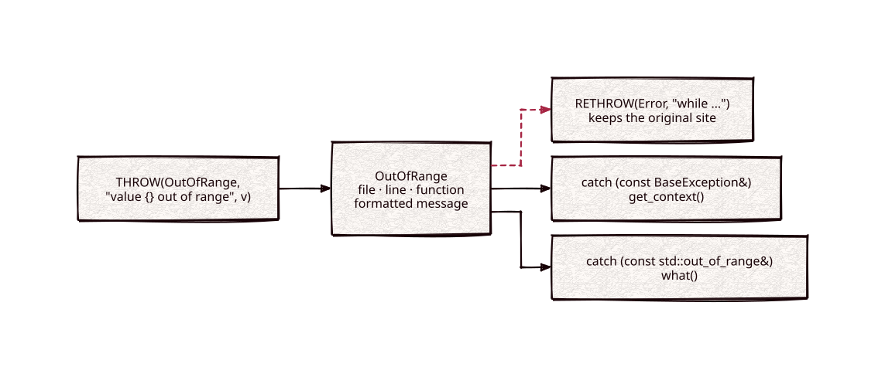

# located-exception

[](https://github.com/Kronuz/located-exception/actions/workflows/ci.yml)
[](LICENSE)


C++20 exceptions that remember where they were thrown and format their message
with `std::format`. One throw is catchable as your type or as the matching
standard exception, and a rethrow keeps the original site. For servers and tools
whose errors need to say where they happened.



## ✨ Highlights

- **The throw site, free.** `THROW(Error, "...")` records the function, file, and
  line.
- **Formatted messages.** `THROW(InvalidArgument, "expected {} args, got {}", 2, n)`.
- **Two identities.** `Error` is also a `std::runtime_error`, `OutOfRange` a
  `std::out_of_range`, `InvalidArgument` a `std::invalid_argument`.
- **Context that survives rethrows.** `RETHROW` adds a message and keeps the
  original site.
- **No dependencies.** `std::format` on C++20, or a passthrough without it.

## 📦 Installation

Requires a C++20 compiler and CMake 3.14 or newer; it compiles one source file.
CI builds it on Linux (x86_64, arm64), macOS (arm64, x86_64), and FreeBSD, plus
ASan, UBSan, and TSan builds.

```cmake
include(FetchContent)
FetchContent_Declare(located_exception
  GIT_REPOSITORY https://github.com/Kronuz/located-exception.git
  GIT_TAG        main)
FetchContent_MakeAvailable(located_exception)

target_link_libraries(my_app PRIVATE located_exception::located_exception)
```

## 🚀 Quick start

```cpp
#include "exception.h"

#include <cstdio>

void load(int n) {
	if (n > 5) { THROW(OutOfRange, "value {} out of range [0, 5]", n); }
}

int main() {
	try {
		try {
			load(7);
		} catch (const BaseException& exc) {   // RETHROW reads a variable named exc
			RETHROW(Error, "while loading config");
		}
	} catch (const Error& e) {
		std::puts(e.get_context());   // "main.cc:7 at load: while loading config"
	}
}
```

[`examples/demo.cc`](examples/demo.cc) compares this with a bare
`std::runtime_error` and shows both catch identities.

## 🎯 When to use it

- ✅ Errors that should report where they came from in logs and responses.
- ❌ Full stack traces: it records one site; see
  [traceback](https://github.com/Kronuz/traceback) for the whole stack.

## 📚 Documentation

- [docs/API.md](docs/API.md): the types, the macros, the formatting backends, and
  caveats.
- [ARCHITECTURE.md](ARCHITECTURE.md): how the constructors capture and chain the
  site.
- [AGENTS.md](AGENTS.md): repository map, invariants, and traps.

## 🛠️ Building and testing

```sh
cmake -B build && cmake --build build && ctest --test-dir build
./build/located_exception_demo
```

## 🤝 Contributing

Issues and pull requests are welcome. Read [AGENTS.md](AGENTS.md) first. CI must
pass on every platform.

## 📄 License

MIT, Copyright (c) 2015-2019 Dubalu LLC. See [LICENSE](LICENSE). Extracted from
[Xapiand](https://github.com/Kronuz/Xapiand).
